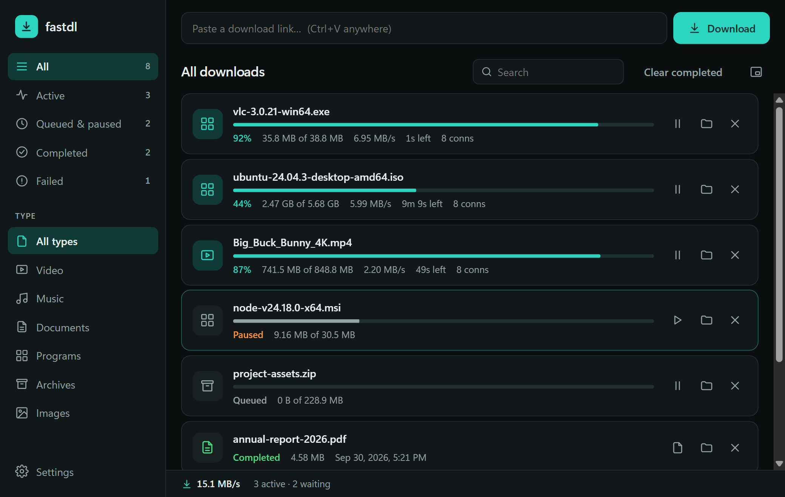

# fastdl

A fast, small, modern download manager for Windows. It's a free, open-source alternative to Internet Download Manager (IDM).

fastdl splits each file into pieces and downloads them over several connections at once, so it's often much faster than downloading in the browser. It ships with a Chrome extension that sends your browser downloads to the app.



## Features

- **Multi-connection downloads.** Files are split into pieces that download in parallel. When one piece finishes early, fastdl splits the biggest remaining piece so every connection stays busy until the end.
- **Pause and resume**, even after closing the app (if the server supports it).
- **Browser extension** for Chrome, Edge, Brave and Opera. Click a download in your browser and fastdl asks where to save it. If fastdl isn't running, the browser downloads normally.
- **Mini view.** A small always-on-top bar with your active downloads (`Ctrl+M`).
- **Clean up in one go.** Select downloads with click, `Ctrl`+click or `Shift`+click, or press `Ctrl+A` for all of them, then `Del` to remove them. Double-click a finished download to open it.
- **No double windows.** When fastdl takes a download, the browser's own "Save as" window never appears, even in browsers that ask where to save every file.
- **Lives in the tray.** Closing the window keeps fastdl running next to the clock, so downloads from your browser still reach it. Click the icon to open it, right-click it to quit. It can also start when you sign in to Windows (Settings, off by default).
- **Queue, speed limit, dark and light themes.**
- **Small.** The installer is about 1.6 MB and the app uses about 30 MB of memory.

## Polite by design (it won't get your IP blocked)

Many servers limit how many connections one person may open, and some temporarily ban IPs that open too many. fastdl is careful:

- 8 connections by default (the same as IDM's default).
- Opens 4 connections at once (browsers use up to 6 per site), then adds the rest one at a time.
- Stops adding connections as soon as a server refuses one, and closes the extras.
- Respects `Retry-After` when a server asks it to wait.
- Identifies itself honestly as `fastdl/<version>` instead of pretending to be a browser.

## Speed

On a local test server that caps each connection at 2 MB/s (like many real download servers):

| File | fastdl | IDM |
|---|---|---|
| 60 MB | 4.9 s (12.2 MB/s) | 5.7 s (10.6 MB/s) |
| 250 MB | 19.0 s (13.1 MB/s) | 19.6 s (12.7 MB/s) |

A single browser-style connection got 1.7 MB/s on the same server. On a server that doesn't cap connections, or when your internet line is the bottleneck, every tool gets the same speed. No download manager can beat your line speed.

You can run the comparison yourself: `node test/vs-idm-local.js` (needs IDM installed and a built engine; see below).

## Install

1. **The app.** From [Releases](../../releases):
   - **Windows:** download `fastdl_x.y.z_x64-setup.exe` and run it. The app isn't code-signed yet, so Windows may show "Windows protected your PC". Click **More info → Run anyway**.
   - **Windows, portable:** download `fastdl_x.y.z_x64-portable.zip` and unzip it anywhere, a USB stick too. See [Portable mode](#portable-mode).
   - **Mac:** download the `.dmg`. It isn't notarized yet, so the first time, right-click fastdl and choose **Open**.
2. **The browser extension (optional).** From the same release:
   - **Ungoogled Chromium and other Chromium builds:** download `fastdl-extension.crx`. Open `chrome://extensions`, turn on **Developer mode** (top right) and drag the `.crx` file onto the page.
     In Ungoogled Chromium you can also set `chrome://flags/#extension-mime-request-handling` to **Always prompt for install** and then just click the `.crx` link on the Releases page.
   - **Chrome, Edge, and any browser that refuses the `.crx`:** download `fastdl-extension.zip` and unzip it. Open `chrome://extensions`, turn on **Developer mode**, click **Load unpacked** and pick the unzipped folder. (Chrome and Edge only accept `.crx` files from their own stores.)
3. **Connect them once.** With fastdl open, click the fastdl extension icon and click **Connect**. fastdl asks "Allow this browser to connect?". Check that it shows the same code as the extension and click **Allow**. That's all.
   Prefer typing? Click **Paste a key instead** in the extension, and copy the key from fastdl → **Settings**.
   If you use IDM too, turn off its browser extension, otherwise both will try to grab downloads.

Both the `.crx` and the unpacked extension have the same fixed extension ID, so fastdl trusts either one. A `.crx` you pack yourself gets a new ID, and fastdl won't accept it.

**Upgrading from 0.1.x:** the extension got a new, permanent ID in 0.2.0. Remove the old fastdl extension from `chrome://extensions`, install the new one, and click **Connect** once. Update the app too: fastdl 0.2.0 only accepts the new extension.

## Where fastdl keeps your settings

fastdl shows the folder in **Settings → Settings are saved in**, with a button to open it. It holds:

- `downloads.json`: your settings and the download list
- `extension-key.txt`: the key the browser extension uses

Installed on Windows, that's `%APPDATA%\com.fastdl.desktop`, and the window's browser data (WebView2) is in `%LOCALAPPDATA%\com.fastdl.desktop`. The `HKEY_CURRENT_USER\Software\fastdl` registry key only records where the installer put fastdl (it's used for updates and uninstalling). fastdl doesn't keep settings in the registry. The only registry value it ever writes is the one Windows uses for **Start fastdl when I sign in** (`HKEY_CURRENT_USER\Software\Microsoft\Windows\CurrentVersion\Run`), and only while that's switched on.

### Portable mode

Put a file named `fastdl.ini` next to `fastdl.exe` (the portable zip already has one) and restart fastdl. It then keeps everything in a `data` folder next to `fastdl.exe` and writes nothing to AppData. Move the folder and your settings move with it. Delete `fastdl.ini` to go back to normal mode.

If fastdl can't write next to the exe (a read-only drive, or a folder like Program Files), it uses the normal folders for that run and tells you so.

**Start fastdl when I sign in** isn't available in portable mode, because it would have to write to the registry.

The portable app needs the Microsoft Edge WebView2 Runtime, which comes with Windows 10 and 11.

## Security

**Extension ↔ app**
- The extension talks to fastdl only through `127.0.0.1:17385`, which other computers can't reach.
- fastdl only accepts requests carrying the extension's fixed ID as their `Origin`. Browsers don't let websites fake that header, so websites can't push downloads into fastdl.
- **Pairing:** fastdl and the extension share a random key. Before sending anything, the extension asks fastdl to sign a random number with it (HMAC-SHA256), so another program listening on that port never receives your links or cookies. Every download request is signed too, so other programs can't add downloads.
- **One-click pairing** hands the key to the extension only after you click **Allow** in fastdl. Both show a 4-digit code worked out from the request, so you can tell your browser's request from one made by another program. Only one request can wait at a time, and it expires after 2 minutes.
  The honest limits: while you pair, the extension can't yet tell the real fastdl from a fake program that took its port while fastdl was closed. (When fastdl is running, it holds the port, so no other program can be there.) And no local scheme like this can stop malware that already runs as your Windows user: it could read the key file directly. Pairing keeps out websites and other programs; it isn't a defence against malware on your PC.
- The `Host` header is checked (blocks DNS-rebinding tricks), and requests have strict size limits and timeouts.

**Downloaded files**
- Finished files get Windows' "downloaded from the internet" mark, just like browser downloads, so SmartScreen and Office Protected View still check them.
- File names from servers are cleaned: no folder tricks (`../`), no invisible characters that could disguise `invoice.exe` as `invoice.pdf`, no Windows device names (`CON`, `NUL`…), no over-long names.
- Every piece the server sends is checked against what was asked for, so a broken server or proxy can't produce a silently corrupted file.
- When resuming, fastdl checks the file hasn't changed on the server (`If-Range`), so you never get a mix of an old and a new version.

**Your data**
- By default the extension has **no access to the websites you visit**. Sending login cookies (for downloads that need you to be signed in) is an opt-in switch, and Chrome asks you to grant that permission first. Cookies are kept in memory only, never written to disk, and are dropped when the download finishes.

The Windows and Mac releases are built by GitHub Actions from this repository's code (see `.github/workflows/release.yml`).

Found a security problem? Please open an issue, or contact the maintainer privately first for anything serious.

## Build from source

Requirements: [Rust](https://rustup.rs), [Node.js](https://nodejs.org) 18+, and on Windows the Microsoft C++ Build Tools ("Desktop development with C++").

```sh
cd app
npm install
npx tauri build          # installer ends up in app/src-tauri/target/release/bundle/
npx tauri dev            # run in development mode
```

The UI in `app/ui/` is plain HTML, CSS and JS with no framework. Opening `app/ui/index.html` directly in a browser shows it with simulated downloads, which is handy for working on the design.

## Tests

```sh
cd app/src-tauri && cargo test --lib   # unit tests: engine, extension endpoint and pairing, portable mode
node test/engine-test.js               # builds the Rust engine and tests it against a throttled, flaky local server
node test/extension-test.js            # the extension's code against the app's real endpoint: pairing, signing (close fastdl first)
node test/pack-extension-test.js       # the .zip/.crx packer (also checks it against Chrome's own packer, if Chrome is installed)
node test/test.js                      # tests the original Node.js prototype (fastdl.js)
```

The engine tests check that files come out byte-for-byte correct, that multiple connections are faster, that dropped connections are recovered, and that pause/resume works.

## Packing the extension

```sh
node scripts/pack-extension.js --out dist                    # fastdl-extension.zip
node scripts/pack-extension.js --out dist --key extension.pem # also fastdl-extension.crx, signed
node scripts/pack-extension.js --verify dist/fastdl-extension.crx
```

The `.crx` has to be signed with the extension's original private key: that key is what gives the fixed ID the app trusts. The script refuses any other key, and checks that `manifest.json` and `bridge.rs` agree on the ID. Releases sign it in GitHub Actions with the key stored in the `EXTENSION_PEM` secret. Never commit the key.

## Project layout

| Path | What |
|---|---|
| `app/src-tauri/src/engine.rs` | Download engine (Rust) |
| `app/src-tauri/src/bridge.rs` | Local endpoint for the browser extension, and pairing |
| `app/src-tauri/src/storage.rs` | Where data is kept (installed or portable mode) |
| `app/ui/` | App interface |
| `extension/` | Browser extension (Manifest V3) |
| `scripts/pack-extension.js` | Builds the extension's `.zip` and signed `.crx` |
| `fastdl.js` | Original Node.js prototype (command line) |
| `test/` | Test servers and tests |

## License

[GPL-3.0](LICENSE). You're free to use, study, change and share fastdl. If you distribute a modified version, it must stay open source under the same license.
